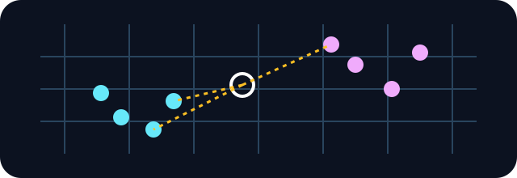

<div align="center">


<p><strong>An interactive 2D KNN classifier for machine-learning fundamentals.</strong></p>
   
<br/>
</div>

## 🧭 Overview
KNN Playground demonstrates k-nearest-neighbors classification in two dimensions. Add labeled training points, move a query point, and inspect the closest samples and majority vote.

## ✨ Features
- 📍 Add class A and class B training samples by clicking.
- 🎯 Move a query point and update its predicted class.
- 🔢 Adjust k to change the number of neighbors.
- 📏 Inspect Euclidean distances and vote counts.
- 🔒 Keep all points in browser memory.

## 🎬 Demo
Start the app; a small two-cluster dataset is loaded. Change k, move the query point, or add new training samples to explore decision changes.

## 🚀 Quick Start
Requires Node.js 20 or newer.

```bash
npm start
```

Open http://127.0.0.1:4181. Run checks with npm test.

## 🧰 Tech Stack
- 🟢 Node.js built-in HTTP server
- 🌐 Browser JavaScript and Canvas
- 🧪 Node.js built-in test runner

## 🗂️ Folder Structure
```text
public/       KNN classifier and interactive plot
test/         Classification tests
assets/       Original SVG artwork
.github/      CI workflow
server.js     Dependency-free static server
```

## 🛣️ Roadmap
- [ ] Add more than two classes.
- [ ] Compare Euclidean and Manhattan distance.
- [ ] Export and import training points as JSON.

## 🤝 Contributing
Contributions are welcome. Keep distance calculations deterministic, document tie-breaking behavior, and add tests for class imbalance and boundary cases.

## 📄 License
MIT. See LICENSE.

<div align="center"></div>
